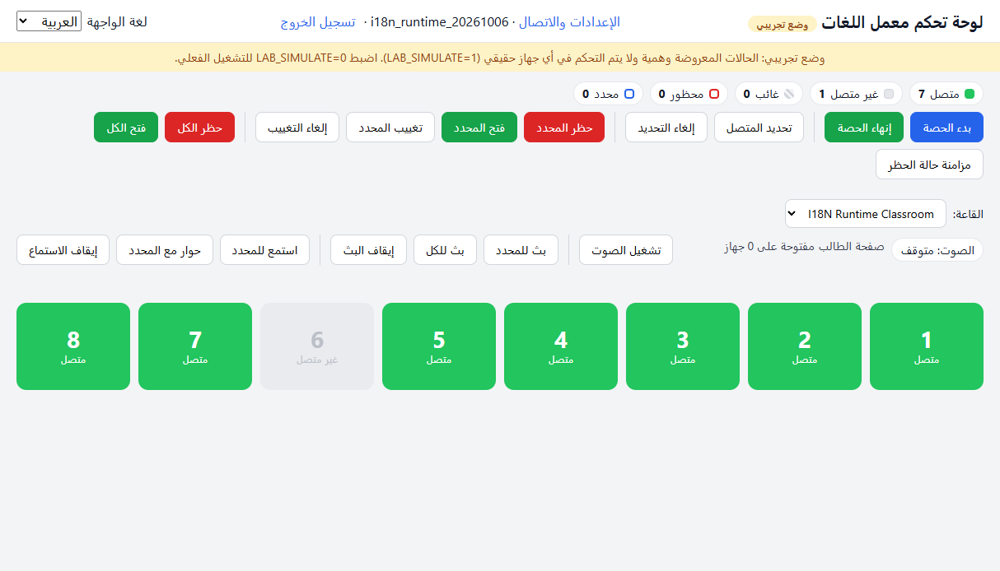
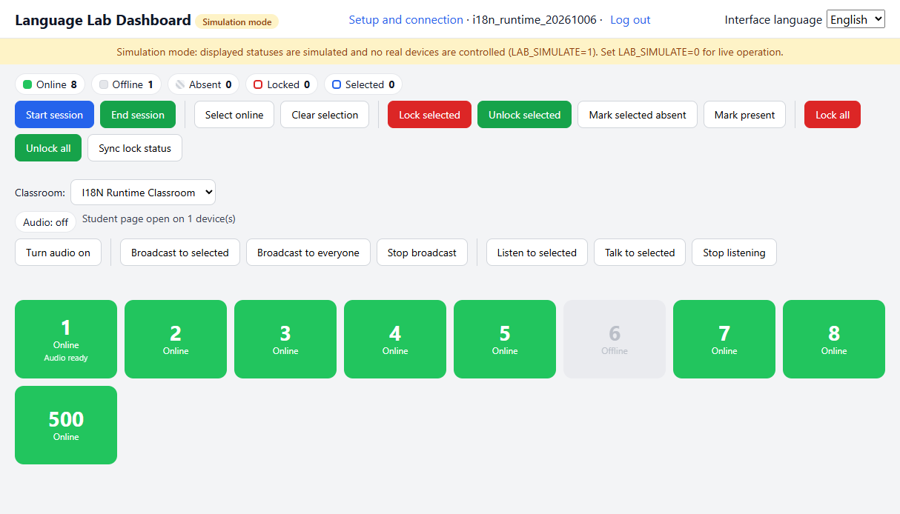
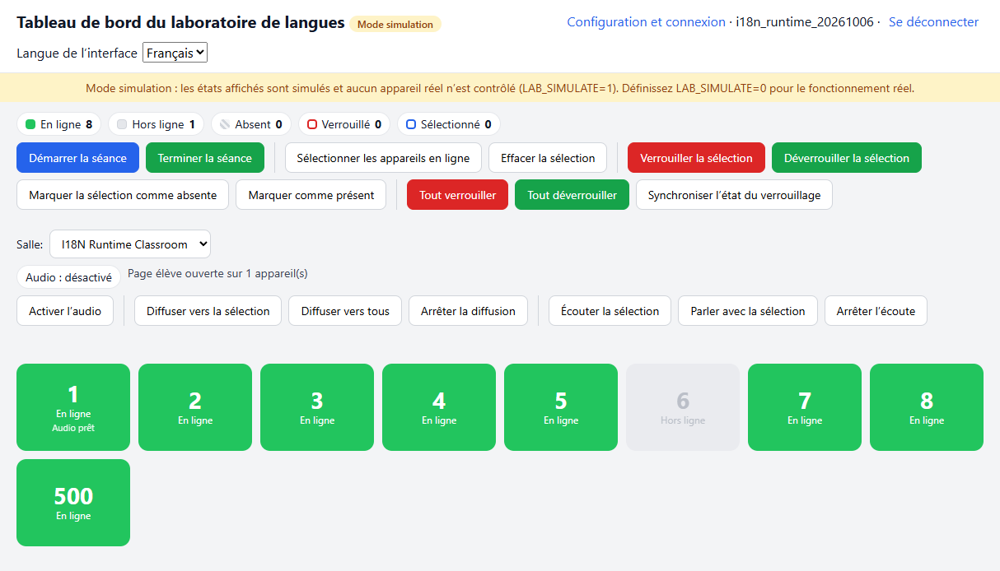
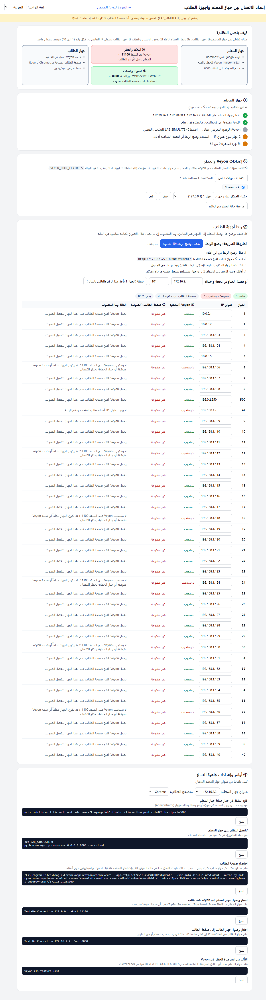
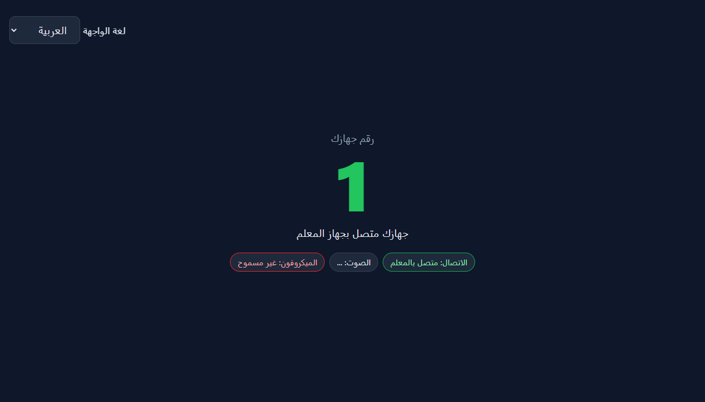

# Language Lab - Stage 2 Runtime Verification

**Date:** 2026-10-06  
**Scope:** English, Arabic, and French interface localization  
**Runtime:** Django development server on `127.0.0.1:8000`, `LAB_SIMULATE=True`  
**Result:** **PASS** for the localization acceptance gate

## Runtime acceptance

| Interface | Runtime direction | Teacher dashboard | Setup/classroom page | Student page | Dynamic/WebSocket text | Validation error |
|---|---|---|---|---|---|---|
| Arabic (`ar`) | RTL | Rendered in Arabic | Rendered in Arabic; table and controls flow RTL | Rendered in Arabic; student connected to teacher | `صفحة الطالب مفتوحة على 1 جهاز` | `عنوان IP غير صالح` |
| English (`en`) | LTR | Rendered in English | Rendered in English | Rendered in English; student connected to teacher | `Student page open on 1 device(s)` | `Invalid IP address` |
| French (`fr`) | LTR | Rendered in French | Rendered in French | Rendered in French; student connected to teacher | `Page élève ouverte sur 1 appareil(s)` | `Adresse IP invalide` |

The language selector was exercised on teacher and student pages. The selected interface language remained in effect when navigating between setup and dashboard pages. It does not change the separate learning-language setting.

### RTL and layout evidence

- Arabic pages reported `lang="ar"` and `dir="rtl"` at runtime. English and French reported `dir="ltr"`.
- In the Arabic dashboard, the first action button was at the right edge and the last action button at the left edge (viewport width: 1214 px; measured x positions: 1105 px and 20 px).
- The Arabic setup table headers flowed right-to-left (first header at x=1048 px, last at x=90 px). The captured page was also visually inspected for cards, forms, status indicators, and spacing.
- English and French dashboard actions began at the left edge (x=20 px), consistent with LTR layout.

## Regression checks

- **Teacher/student WebSockets:** The runtime server logged successful handshakes and connections for `/ws/teacher/` and `/ws/student/`. The student page displayed its connected state, and the teacher dashboard received the live student-presence update in each language.
- **Validation:** An invalid IP entered through the setup form produced HTTP 400 and displayed the corresponding Arabic, English, or French message. The invalid value was not saved.
- **Classroom selection:** The teacher dashboard switched to another classroom and back to the isolated runtime classroom; the selected room and its device list updated.
- **Device status and Veyon controls:** In simulation, the lock and unlock API actions for a temporary test device each returned HTTP 200 and changed the displayed status as expected. The device and other temporary runtime records were removed after testing.
- **Setup lock-feature API:** The GET endpoint returned HTTP 200 in the browser. A regression test covers both GET and POST; previously duplicate Python function definitions caused GET to return 405.
- **Audio/signaling UI:** Teacher audio controls remained available, and the student WebSocket connection was established. The browser denied microphone access, so live WebRTC media was not verified. Real Veyon hardware was also unavailable; Veyon actions were verified in simulation only.

## Automated checks

- `manage.py test -v 2`: **22 tests passed**
- `manage.py check`: **No issues**
- Pylance syntax check for the updated setup view: **No syntax errors**
- Editor problems for the updated Python files: **No errors**

## Screenshots

## Runtime fixes found during verification

- Named placeholders in JavaScript were left visible because Django's `interpolate` helper was called without its named-format flag. The affected dynamic messages now pass the flag, and the runtime counter renders as a number in all three languages.
- The setup lock-feature GET and POST handlers shared the same Python name, so the POST handler replaced the GET handler. They now share one method-guarded view, with a regression test for both methods.

## Conclusion

The three interface languages render at runtime, Arabic uses RTL layout, English and French use LTR layout, and localized validation and WebSocket-driven status messages were observed. The localization acceptance gate **passes**. Live microphone/WebRTC media and non-simulated Veyon hardware remain environment-dependent and were not claimed as verified.
